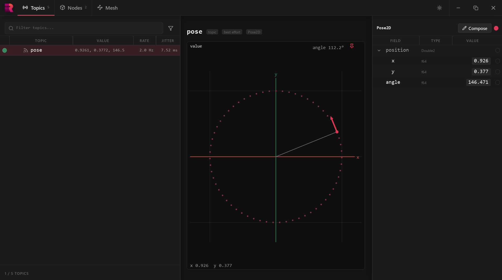

# Introduction

RANT is the Robotics Automation Networking Toolkit. It consists of a small pub sub middleware library and a set of powerful and easy to use tooling built around it to make development as easy as possible.

## Install

**Linux & MacOS**
```sh
curl -fsSL https://get.rantlib.dev | sh
```

**Windows**
```sh
irm https://get.rantlib.dev | iex
```

## Start your first node

If this is your first time using RANT it will be useful to see an example. We will create a new rant project with the template workspace:

```sh
mkdir Example
cd Example
rant new workspace --lang python
```

This will initialize the current directory with a workspace template. We will use python, but you may use cpp, or csharp as well.
Now lets see what exists here. This will list all rant nodes in the workspace and will also show a list of online nodes if there are any.
You should see two: `talker` and `listener`:

```console
$ rant ls nodes
NODES
  (none)

NOT RUNNING
  Example/listener  python  src/listener.py
  Example/talker    python  src/talker.py
```

The example includes one group file `Example.run`. This defines a node group that runs together.
Start it:

```console
$ rant run Example
Example/Example

  ● talker    started  pid 26788   logs/talker.log
  ● listener  started  pid 62548   logs/listener.log

2 started, all running after 2 s
```

Now that both nodes are running we can list what is active on the network:

```console
$ rant ls nodes
NODES
  Example/Example:
    ● talker      ● listener

NOT RUNNING
  (none)

$ rant ls entities
ENTITIES
  Pose  topic
```


As you can see our two nodes are running, and there is a topic named `Pose`. Lets see what data is on it:

```console
$ rant sub Pose
Pose  from talker     2.0 Hz  9 messages
position:
  x: -0.82
  y:  0.57
angle:     16.67
```

This is great but it is not very visual. So lets open the explorer:

```sh
rant explorer
```

now we can see the list of topics (just Pose). Click on `Pose` to show it's value:


